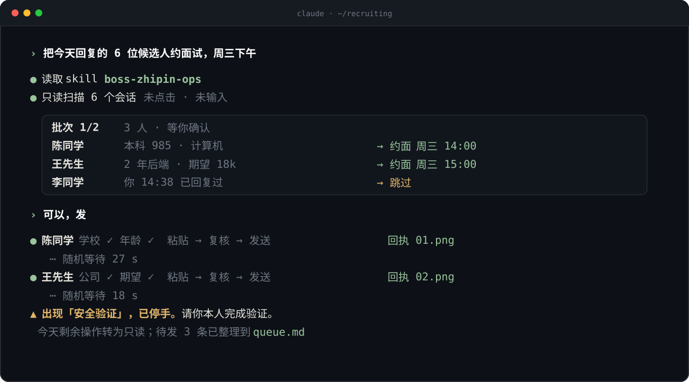

<p align="center">
  <picture>
    <source media="(prefers-color-scheme: dark)" srcset="assets/banner-dark.svg">
    
  </picture>
</p>

<p align="center">
  <a href="README.md">简体中文</a> · <b>English</b>
</p>

<br>

**bossops** is a Claude Code skill for working a [BOSS Zhipin](https://www.zhipin.com) recruiter account (China's largest hiring chat app). With it installed, Claude reads résumés, messages candidates and schedules interviews by a set of rules learned the hard way: **send less, send right, stop when flagged.**

<p align="center">
  
</p>

## How it works

**Three questions before starting.** Desktop client or web? Has the account been flagged today, and how much has it sent? Which mode for this batch? If a security check appeared today, Claude goes read-only.

**Look, report, then act on your yes.** Each batch starts read-only. Claude lists who, what, and the exact text of every message. Nothing is clicked or typed until you approve that batch.

**Slow, and right every time.** Every step waits a random interval; at most 6 long messages an hour. Before each send Claude checks two identity fields, makes sure you haven't already replied, and keeps the text to one paragraph (Enter sends). Each send gets a screenshot receipt, saved to disk immediately.

**Stop when flagged.** A security check means hands off: you complete it yourself. Logouts get three retries at most. A possible mis-send means stop and ask, never a "correction" message.

> [!IMPORTANT]
> bossops ships **no** detection evasion: no mouse-path simulation, no fake typing rhythm, no fingerprint spoofing, no CAPTCHA solving, no sock-puppet accounts. Synthetic input is visible at the OS level; disguising it only delays the ban on a real-name account. The randomness here is **rate limiting**, not camouflage.

## Install

```text
/plugin marketplace add kizzhang/bossops
/plugin install bossops@bossops
```

Or copy the skill:

```bash
git clone https://github.com/kizzhang/bossops
cp -r bossops/skills/boss-zhipin-ops ~/.claude/skills/
```

No commands to remember. Mention anything BOSS-related and Claude reads the rules first.

The skill itself is written in Chinese, since the platform and its users are.

<br>

<p align="center">
  <sub>Not affiliated with BOSS Zhipin. Read the platform's terms before automating anything; the account and the risk are yours. · MIT</sub>
</p>
