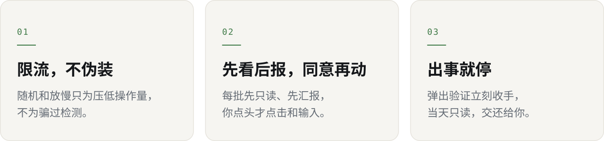

<p align="center">
  <picture>
    <source media="(prefers-color-scheme: dark)" srcset="assets/banner-dark.svg">
    
  </picture>
</p>

<p align="center">
  <b>简体中文</b> · <a href="README.en.md">English</a>
</p>

<p align="center">
  
  
  
</p>

<br>

**bossops** 是一份 Claude Code skill。装上以后，Claude 代你在 BOSS 直聘招聘端看简历、发消息、约面试时，会按一套从真实事故里总结出来的规矩干活：**少发、发对、出事就停。**

<p align="center">
  
</p>

## 它怎么工作

**开工前先问三件事。** 走桌面客户端还是网页端；账号今天有没有弹过验证、已经发了多少条；这一批用哪种模式。今天弹过验证，AI 就只读，不再点。

**先看，后报，你同意了再动。** 每一批先只读扫描，把「看谁、做什么、每条文案原文」列给你。你点头，它才在 BOSS 里点击和输入；你说「直接发」，也只管这一批。

**慢慢发，每条都发对。** 每一步都随机停顿，每小时最多 6 条长消息。发之前至少核对两项身份信息，先看你是不是已经回过，文案只写一段、不带换行（BOSS 回车就发）。每条截图留回执，结果马上写到磁盘。

**出事就停。** 弹出安全验证，立刻收手交给你本人处理；掉线最多重试 3 次；怀疑发错，先停下截图问你，不会自己补发一条「更正」。

## 三条原则

<p align="center">
  <picture>
    <source media="(prefers-color-scheme: dark)" srcset="assets/principles-dark.svg">
    
  </picture>
</p>

> [!IMPORTANT]
> bossops **不提供**任何躲过平台检测的办法：不模拟鼠标轨迹，不伪造打字节奏，不改设备指纹，不解验证码，不开小号。程序发出的点击在系统层面本来就看得出来，装得再像，也只是把封号的时间往后推，押上的是你的实名账号。

## 安装

在 Claude Code 里作为插件安装：

```text
/plugin marketplace add kizzhang/bossops
/plugin install bossops@bossops
```

或者直接把 skill 拷进去：

```bash
git clone https://github.com/kizzhang/bossops
cp -r bossops/skills/boss-zhipin-ops ~/.claude/skills/
```

装好以后不用记任何命令。只要说的事和 BOSS 有关，比如「把这几个人约面试」「BOSS 又弹验证了」，Claude 会自己先读这份规范。

## 细节

<details>
<summary><b>节奏与外发上限</b></summary>
<br>

<picture>
  <source media="(prefers-color-scheme: dark)" srcset="assets/rhythm-dark.svg">
  
</picture>

| 场景 | 随机区间 |
|---|---|
| 点开一个会话前 | 0.8 – 2.5 s |
| 读完、进入下一个前 | 2 – 5 s |
| 每 3–5 人后长停顿 | 10 – 25 s |
| 两条消息之间 | 15 – 40 s |
| 外发上限（可调） | 每小时 ≤ 6 条，每天 ≤ 20 条 |

真正决定风险的是外发量。第二次弹验证，就是在 40 分钟里发了 9 条长消息之后。

</details>

<details>
<summary><b>出事时怎么收手</b></summary>
<br>

| 看到 | 马上做 | 别做 |
|---|---|---|
| 安全验证 | 停手，交给本人验证，当天转只读 | 自己点、换个办法继续 |
| 弹回登录页 | 最多再试 3 次，然后请你重新登录 | 反复刷新、代登录 |
| 页面卡死 | 先确认最后一步有没有发出去，再重载一次 | 连续重载、接着跑 |
| 可能发错或发重 | 停下截图，由你决定怎么补救 | 自己再发一条「更正」 |

</details>

<details>
<summary><b>这些规则是怎么来的</b></summary>
<br>

一次真实招聘，四天，同一个账号：

1. **90 秒点开 40 个会话**，弹出第一次验证。抓到的数据只存在页面变量里，页面一跳全丢了。
2. **悄悄把延时砍掉一半**去赶进度，又用定频滚动扫了 597 行。页面卡死、掉线，网页端被限制。
3. **40 分钟发出 9 条长消息**，大段句子都一样。桌面端弹出第二次验证。
4. **凭截图认字**，把名字里的一个字认成了形近字，写进了两份文件。
5. **用户自己也在回消息**，有两位候选人用户刚回过。因为发前先看了会话，才没有重发。

每一条对应的规则见 [incidents.md](skills/boss-zhipin-ops/references/incidents.md)。

</details>

## 里面有什么

```text
skills/boss-zhipin-ops/
├── SKILL.md            模式 · 限流 · 核验 · 约面试 · 收手
├── references/
│   ├── app-desktop.md  桌面客户端：校准、定位、粘贴、让屏
│   ├── web-chrome.md   网页端：DOM、虚拟列表、禁止写法
│   └── incidents.md    五次事故 → 对应规则
└── evals/              3 个测试场景
```

<br>

<p align="center">
  <sub>与 BOSS 直聘官方无关。使用自动化工具前请先读平台的用户协议，账号和风险都是你自己的。· MIT</sub>
</p>
