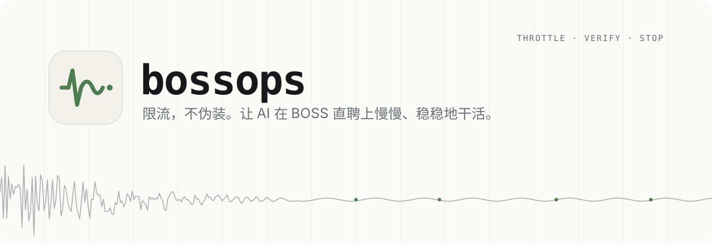
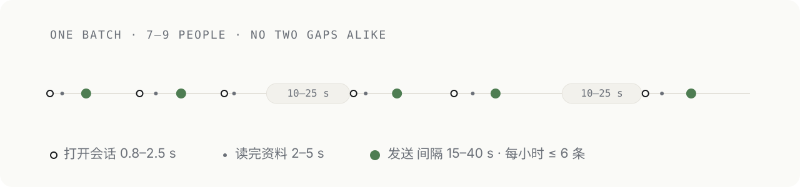

<p align="center">
  <picture>
    <source media="(prefers-color-scheme: dark)" srcset="assets/banner-dark.svg">
    
  </picture>
</p>

<p align="center">
  <a href="#安装">安装</a> ·
  <a href="#三条原则">原则</a> ·
  <a href="#节奏">节奏</a> ·
  <a href="#出事怎么办">出事怎么办</a> ·
  <a href="skills/boss-zhipin-ops/references/incidents.md">事故记录</a>
</p>

<p align="center">
  
  
  
</p>

---

**bossops** 是一份给 Claude Code 用的 skill：让 AI 代你在 **BOSS 直聘招聘端**看简历、发消息、约面试，并且不把你的实名账号送进风控。

它不教 AI 怎么「装得像人」。程序发出的点击在系统层面本来就看得出来，装得再像，也只是把封号往后推。所以它只做三件事：**少发、发对、出事就停。**

> 这份规则是一次真实招聘里四天的操作换来的：同一个账号先后在网页端和桌面端各弹了一次安全验证，网页端随后被限制。每条规则都对应一次真出过的事。

## 安装

**作为插件**（推荐）

```text
/plugin marketplace add kizzhang/bossops
/plugin install bossops@bossops
```

**或者直接拷贝**

```bash
git clone https://github.com/kizzhang/bossops
cp -r bossops/skills/boss-zhipin-ops ~/.claude/skills/
```

装好后不用记命令。只要你说的话和 BOSS 有关，比如「把这几个人约面试」「BOSS 又弹验证了」，Claude 会自己先读这份规范。

## 三条原则

| 原则 | 意思 | 落到实处 |
|---|---|---|
| **限流，不伪装** | 随机和放慢是为了压低单位时间的操作量，不是为了骗过检测 | 不模拟轨迹、不伪造打字、不改指纹、不解验证码 |
| **先看后报，同意再动** | 每批先只读，把「看谁、发什么、文案原文」报给你，你点头才动手 | 当天弹过验证就转成只读：AI 拟稿，你自己发 |
| **发对比发快重要** | 打开会话至少核对两项身份；先看你是不是已经回过；单段无换行 | 每条截图回执，结果立刻落盘 |

## 节奏

<p align="center">
  <picture>
    <source media="(prefers-color-scheme: dark)" srcset="assets/rhythm-dark.svg">
    
  </picture>
</p>

| 场景 | 随机区间 |
|---|---|
| 点开一个会话前 | 0.8 – 2.5 s |
| 读完、进入下一个前 | 2 – 5 s |
| 每 3–5 人后长停顿 | 10 – 25 s |
| 两条消息之间 | 15 – 40 s |
| 外发上限 | 每小时 ≤ 6 条，每天 ≤ 20 条 |

真正决定风险的是**外发量**，单条快慢的影响小得多。第二次验证就出现在 40 分钟发了 9 条长消息之后。

## 出事怎么办

| 看到 | 马上做 | 别做 |
|---|---|---|
| 安全验证 | 停手，交给本人验证，当天转只读 | 自己点、换个办法继续 |
| 弹回登录页 | 最多再试 3 次，然后请你重新登录 | 反复刷新、代登录 |
| 页面卡死 | 先确认最后一步有没有发出去，再重载一次 | 连续重载、接着跑 |
| 可能发错 / 发重 | 停下截图，由你决定怎么补救 | 自己再发一条「更正」 |

## 里面有什么

```text
skills/boss-zhipin-ops/
├── SKILL.md            模式 · 限流 · 核验 · 约面试 · 收手
└── references/
    ├── app-desktop.md  桌面客户端：校准、定位、粘贴、让屏
    ├── web-chrome.md   网页端：DOM、虚拟列表、禁止写法
    └── incidents.md    五次事故 → 对应规则
```

## 不做清单

不解验证码 · 不模拟鼠标轨迹 · 不伪造按键节奏 · 不改设备指纹 / UA / 代理 · 不开小号 · 不代登录 · 不买付费推广

---

<sub>与 BOSS 直聘官方无关。使用自动化工具前请先读平台的用户协议；账号是你的，风险也是你的。MIT License.</sub>
